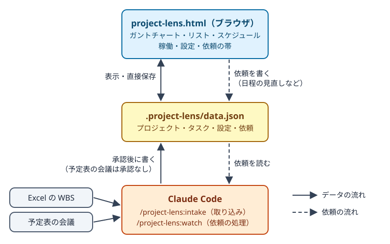
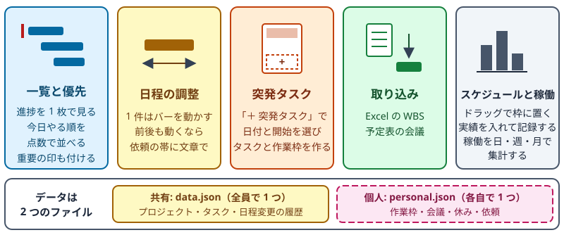
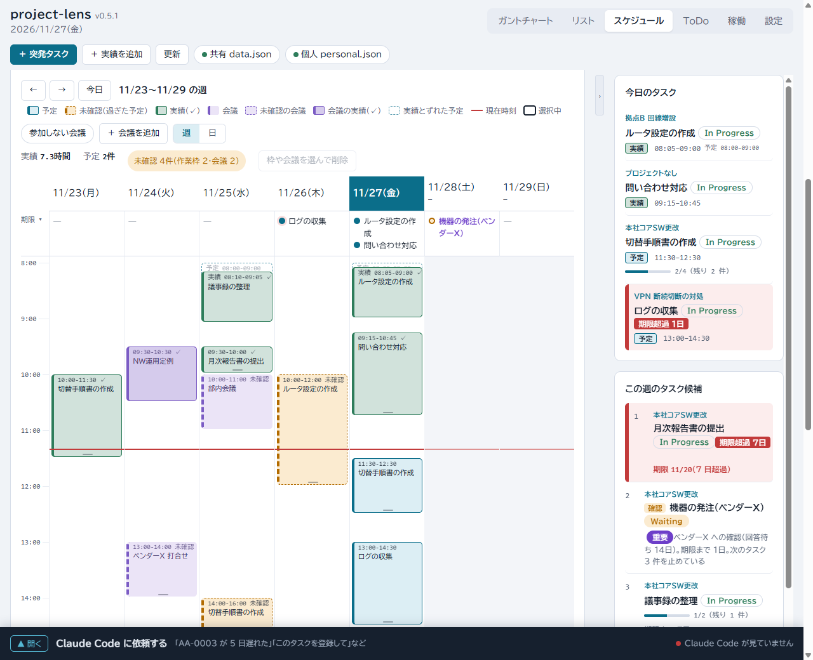
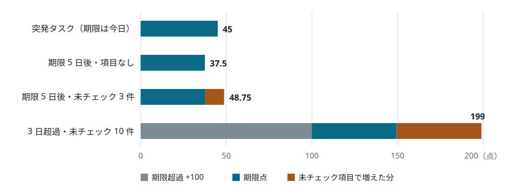
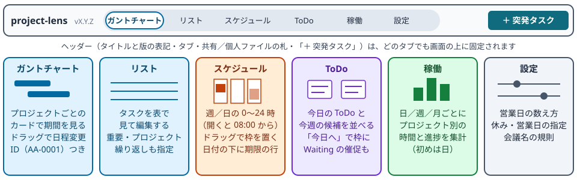

# project-lens

ネットワーク設備の管理者が、複数のプロジェクトと自分のタスクを 1 枚の画面で管理する Claude Code プラグインです（Windows 専用）。次を実行すると、架空のサンプルデータ入りの画面が作られます。

```
/project-lens:init --sample
```



*図 1: 全体図。画面と Claude Code が、同じデータ（共有の `data.json` と個人の `personal.json`）を読み書きします。*

## 機能



*図 2: 5 つの機能と、データの 2 つのファイル。複数人では、共有ファイルを全員で使い、個人ファイルは各自で持ちます。*

## 導入方法

| 必要なもの | 内容 |
|---|---|
| OS・Claude Code・ブラウザ | Windows。Claude Code は必須。ブラウザは Edge か Chrome |
| Node.js | 24 以上 |
| Python | 3.12 以上。Excel の WBS を取り込むときだけ |

```
/plugin marketplace add asama0101/project-lens
/plugin install project-lens@project-lens
/project-lens:init
```

そのあと、Edge か Chrome で `project-lens.html` を開き、共有ファイル（`.project-lens/data.json`）と個人ファイル（`.project-lens/personal.json`）を選びます。2 つとも選ぶと画面が開き、左上の `project-lens` の横に版の表記（`v` で始まる番号）が出ます。どのファイルを開いているかは、ヘッダーの札（共有・個人）に出て、押すと詳細と「別のファイルを選ぶ」が開きます。複数人での置き方と、個人ファイルの場所を変える `--mine` は、[利用ガイド](docs/guide.md#2-初回の準備)を見てください。

**すでに `project-lens.html` があると、`init` は新しい版に置き換えます。** 手で直していたときは、先に別の名前でコピーします（`data.json`・`personal.json` は変わりません）。オフラインでの導入、更新、アンインストール、動作環境の確認（`/project-lens:doctor`）は、[利用ガイド](docs/guide.md)を見てください。

## 使い方

### 毎朝の流れ

| 1. 「この週のタスク候補」を見る | 2. 時間枠へドラッグする | 3. 実績を入れる |
|---|---|---|
|  |  |  |

「この週のタスク候補」のタスクを、スケジュールの今日の列へドラッグすると、1 時間の予定の枠が置かれます（15 分刻み）。長さは、枠の下端をつかんで変えます。詳しい手順は、[利用ガイド](docs/guide.md#毎朝の流れ)にあります。実績を入れた枠は、実績の時刻の 1 つのブロックになります。

### 優先順位の決まり方



*図 3: 点数の計算例（重要なし）。前のタスクが未完了のタスクも、「前のタスク待ち」の理由つきで載ります（点数は同じ規則）。*

| 項目 | 点数 |
|---|---|
| 期限超過 | +100 |
| 期限点 | 残り 30 日以内は (30 − 残り日数) × 1.5 |
| 未チェックの項目 | 期限点を最大 2.0 倍（`Waiting` は 1 倍） |
| 重要 | +12 |
| `Waiting` の回答予定日の超過 | +40 |

### 突発タスクの登録


*図 4: 「＋ 突発タスク」から登録する流れ。承認と見張りは要りません。*

### 依頼の帯から日程を頼む


*図 5: 日程を変える流れ。「承認して反映する」を押すまで、期限は変わりません。*

Claude Code で `/project-lens:watch` を 1 回実行し、画面下端の帯に依頼を書きます（例: `AA-0003 が 5 日遅れた（原因: ベンダー）`）。

### 取り込み


*図 6: Excel の WBS と規則の取り込み。予定表の会議だけは、承認なしで更新します。*

### コマンド一覧

| コマンド | 使いどころ |
|---|---|
| `/project-lens:init` | セットアップ（`--sample` でサンプルデータ入り。`--mine <ファイル>` で個人ファイルの場所を指定） |
| `/project-lens:watch` | 依頼の帯から届く依頼を処理する |
| `/project-lens:intake` | Excel の WBS・予定表の会議の取り込み |
| `/project-lens:mcp` | 予定表で使う MCP の指定 |
| `/project-lens:doctor` | 動作環境の診断（何も変更しない） |

### 画面の見方



*図 7: 画面上部のヘッダーと 6 つのタブ。*

図には出ていませんが、スケジュールと稼働の間に「ToDo」タブ（左に今日の枠があるタスクの「今日の ToDo」、右にその週の未完了のタスクを優先順位の順に理由つきで並べた「この週のタスク候補」、完了の入力欄、回答予定日を過ぎた `Waiting` のタスクの「催促」の組）があります。期間ごとのタスクの見返し（完了の件数・進捗・予定と実績の時間）は、稼働タブにあります。ガントチャート・リストの「この週のタスク候補」の行からも「今日へ」で今日の枠に入れられます。ToDo タブでは、週のタスクを「今日へ」（またはドラッグ）で今日の予定の枠に入れることと、画面を移らずに突発タスクを登録することもできます。

日付の欄は、`2026/10/20`・`20261020`・`2026年10月20日` のどれでも打てます。横の「📅」で、カレンダーからも選べます。各タブの操作は、[利用ガイド](docs/guide.md#画面の見方)にあります。

## 困ったとき

| 症状 | 対処 |
|---|---|
| 帯が「見ていません」になっている | `/project-lens:watch` を実行します。 |
| 「直接保存に対応していません」と出る | Edge か Chrome で開きます。 |
| `/project-lens:doctor` に `[NG]` と出る | `→` で始まる手順に、上から従います。 |

ほかの症状と、データファイルを戻す手順は、[利用ガイド](docs/guide.md#困ったとき)を見てください。設定タブの項目は、[利用ガイド](docs/guide.md#設定)にあります。

## ライセンス

MIT（[LICENSE](LICENSE)）
