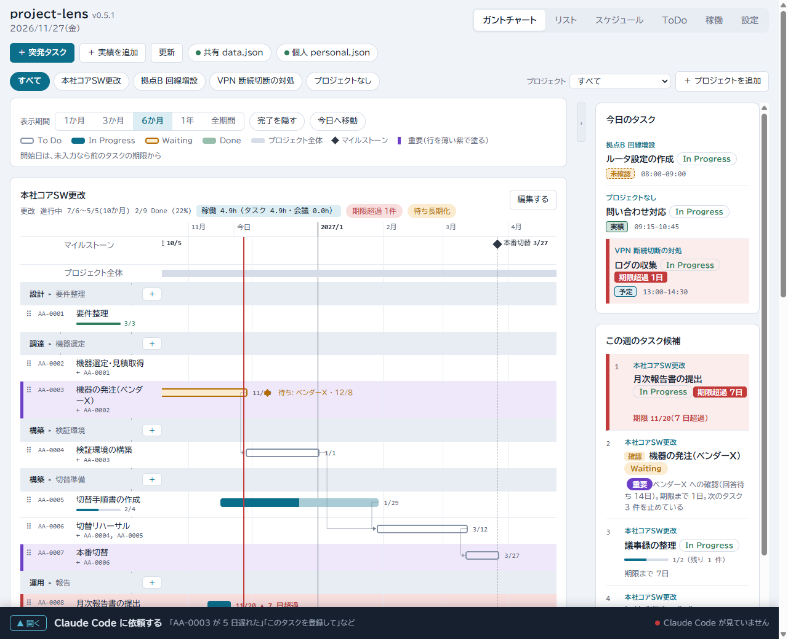

# project-lens

ネットワーク設備の管理者が、複数のプロジェクトと自分のタスクを 1 枚の画面で管理する Claude Code プラグインです（Windows 専用）。データは JSON ファイル 1 つ（`.project-lens/data.json`。以下 `data.json`）、画面は HTML ファイル 1 つ（`project-lens.html`）です。画面の下端には、日程の変更などを Claude Code に頼む入力欄（依頼の帯）があります。

プラグインを入れたあと、プロジェクトのフォルダで Claude Code を開いて次を実行すると、架空のサンプルデータが入った画面が作られます。

```
/project-lens:init --sample
```


*図 1: 全体図。画面は data.json を表示して、直接保存します。Excel・予定表の取り込みと、依頼の帯から届く依頼の処理は、Claude Code が受け持ちます。*

## 機能

| 機能 | できること |
|---|---|
| 一覧と今日の優先 | 複数プロジェクトの進捗をガントチャートとリストで見て、今日やるタスクを、点数で決めた順に並べます。 |
| 日程の調整 | 1 つのタスクはバーのドラッグで、前後にまたがる変更は依頼の帯に文章で頼んで変えます。 |
| 取り込み | Excel の WBS（作業分解表）と予定表（Outlook などのカレンダー）の会議を取り込みます。 |
| スケジュールと稼働 | タスクの作業枠（タスクに割り当てる時間帯）をスケジュールに置き、プロジェクト別に作業と会議の時間を集計します。 |

- **今日の優先**: 期限・未チェックの項目数・重要度・回答予定日から点数を付け、その順に並べます。画面には並び順と理由を出し、点数そのものは表示しません（次のタスクを止めている数は、理由として表示するだけで、点数には使いません）。前のタスクが完了していないタスクは、期限を過ぎていても載りません（前のタスクを先に終わらせます）。遅延はバッジで知らせます。
- **回答待ちの催促**: `Waiting` のタスクに回答予定日を入れると、過ぎたときに「今日の優先」で催促として上がります。
- **定例タスク**: 編集の窓の「繰り返し」を毎週・毎月にすると、完了したときに次回のタスクを作ります。

1 人で使う前提です。複数人が同じ `data.json` を同時に編集する用途は想定していません。

## 導入方法

| 必要なもの | 内容 |
|---|---|
| OS | Windows |
| Claude Code | 必須です。 |
| Node.js | 24 以上が必須です。外部のパッケージは使いません。 |
| ブラウザ | Edge か Chrome が必要です（ファイルへの直接保存に使います）。 |
| Python 3.12 以上 | Excel の WBS を取り込むときだけ使い、標準ライブラリの venv と ensurepip が要ります。 |

venv は専用の仮想環境を作る機能、ensurepip は pip（Python のパッケージ入れ）を入れる機能です。

ネットワーク接続は、次の 4 つのときに使います。

- 導入（GitHub）。
- 祝日の取得（内閣府）。
- `/project-lens:doctor` の最新版の確認（GitHub）。
- Excel 用パッケージの取得（PyPI）。

足りないものは、`/project-lens:doctor` で調べられます（「動作環境の確認」を参照）。

### 1. プラグインを入れる

Claude Code で、次の 2 つを実行します。1 つ目で GitHub のリポジトリをマーケットプレイス（プラグインの配布元）として登録し、2 つ目でプラグインを入れます。

```
/plugin marketplace add asama0101/project-lens
/plugin install project-lens@project-lens
```

GitHub に接続できない環境では、リポジトリを持ち込んで、そのフォルダを登録します。

1. 別の環境で、`git clone https://github.com/asama0101/project-lens.git` を実行します。または、GitHub の「Code」→「Download ZIP」で取得します。
2. ZIP は展開し、`.claude-plugin` フォルダがある階層を使います。
3. そのフォルダを、媒体で持ち込みます。
4. 次の 2 つを実行します（`D:\tools\project-lens` に置いた例）。

```
/plugin marketplace add D:\tools\project-lens
/plugin install project-lens@project-lens
```

持ち込んだフォルダは、入れたあとも消さずに置きます。更新のときに読み直すためです。

### 2. 初回の準備

**すでに `project-lens.html` があると、新しい版に置き換わります。** 画面を手で直していたときは、実行の前に別の名前でコピーします。戻すときは、そのコピーを `project-lens.html` の名前に戻します。`data.json` は変わりません。

管理したいプロジェクトのフォルダで Claude Code を開き、次を実行します。

```
/project-lens:init
```

試すだけなら、空の別フォルダで `--sample` を付けて実行します。プロジェクトのフォルダで `--sample` を実行すると、サンプルの `data.json` ができ、あとで `--sample` なしで実行しても空のデータにはなりません（サンプルを消すときは、`.project-lens/` を削除します）。

`--sample` のとき、次のように出ます。

```
.project-lens/data.json: 作りました（サンプルデータ）
project-lens.html: 作りました
.gitignore: 変更しませんでした（この場所も親のフォルダにも .git がないため、.gitignore は変更しません）

次の手順: ブラウザで project-lens.html を開き、「ファイルを開く」で .project-lens/data.json を選びます。
```

1. `project-lens.html` を Edge か Chrome で開き、「ファイルを開く」で `.project-lens/data.json` を選びます。以後、画面での変更は、`data.json` に直接保存されます。
2. 「＋ プロジェクトを追加」から、プロジェクトを登録します。タスクは、ガントチャートとリストの見出し行の「＋」で足します。

次回からは、`project-lens.html` を開くだけで、前回の `data.json` が開きます。アクセス許可の確認が出たときは、開始画面の「前回のファイル（ファイル名）を開く」を押します。

- `.git` があるフォルダでは、`.gitignore` に `.project-lens/` を追記します（UTF-8 の `.gitignore` だけ）。
- サンプルの日付は 2026 年 7 月〜2027 年 2 月です。開いた日によっては、期限超過が多く出ます。ブラウザのアドレス欄に出る `file:///` から始まる `project-lens.html` のパスの末尾に `?today=2026-10-20` を付けて開くと、その日を今日として表示します（ダブルクリックでは付けられません）。

<details>
<summary>SharePoint Online に置いた data.json を使う（動作は未確認）</summary>

ローカルに置けないときは、ドキュメントライブラリをネットワークドライブに割り当て、そこの `data.json` を「ファイルを開く」で選びます（https の URL は指定できません）。**この方法は、動作を確かめていません。** 先に `data.json` のコピーで試します。画面での編集と保存だけを想定しています。取り込みと `/project-lens:watch` が、このドライブの `data.json` を扱えるかは、確かめていません。

</details>

### 更新

更新の前に、`project-lens.html` を別の名前でコピーします（`init` は、コピーを作りません）。Claude Code の `/plugin` 画面で、project-lens を更新します。持ち込んだフォルダから入れたときは、先にそのフォルダを新しい版に差し替えます。そのあと、使っている作業フォルダごとに `/project-lens:init` を実行します。`project-lens.html` だけが新しい版になり、`data.json` は変わりません。

### 動作環境の確認

別の PC で使い始めるときや、動かないときは、Claude Code で `/project-lens:doctor` を実行します。次の 7 項目を調べて、足りないものと対処の手順を表示します。何も変更しません。

| 項目 | 調べること | 区分 |
|---|---|---|
| OS | Windows であること | 必須 |
| 実行環境 | Node.js が 24 以上であること | 必須 |
| 保存先 | 書き込めるフォルダであること | 必須 |
| 祝日一覧 | 内閣府へ接続できること | 任意 |
| Excel の読み取り | Python・pip・openpyxl（Excel を読む Python ライブラリ）が使えること | 任意 |
| 予定表の MCP の指定 | 予定表につなぐ MCP が指定してあること | 任意 |
| プラグインのバージョン | 今の版を表示し、GitHub から入れたときは最新版か確認すること | 情報 |

MCP は、Claude Code が外部のツール（予定表など）に接続する仕組みです。保存先は、プラグインのデータを置くフォルダです。

項目ごとに `[OK]`・`[NG]`・`[任意]`・`[情報]` と、`→` で始まる対処の手順が出ます。必須の項目が足りないと、終了コード 3 で終わります。任意の項目だけが足りないときは、0 です。

Claude Code を使わずに、コマンドプロンプトで実行するときは、次のようにします（`<版>` は、`cache\project-lens\project-lens` の下にあるフォルダの名前です）。PowerShell では、`%USERPROFILE%` を `$env:USERPROFILE` に替えます。

```
node "%USERPROFILE%\.claude\plugins\cache\project-lens\project-lens\<版>/tools/doctor.js" --data "%USERPROFILE%\.claude\plugins\data\project-lens-project-lens"
```

環境変数 `PROJECT_LENS_HOME` を設定しているときは、`--data` より優先されて、そのフォルダが保存先になります。

### アンインストール

**プラグインを削除すると、保存先（`%USERPROFILE%\.claude\plugins\data\project-lens-project-lens`）が消えます。** 消えるのは、Excel 用の Python パッケージを入れた専用の venv（`venv` フォルダ）と、予定表の MCP の指定 `project-lens-mcp.json` です。

保存先ごと削除するときは、Claude Code で次を実行します。

```
/plugin uninstall project-lens@project-lens
```

保存先を残して削除するときは、ターミナルで次を実行します。

```
claude plugin uninstall project-lens@project-lens --keep-data
```

作業フォルダの `.project-lens/data.json`、`.project-lens/data.json.bak`（コマンドでの直前の保存の前の版）、`project-lens.html` は残ります。システムの Python のユーザー領域に入れた openpyxl も残ります（`pip uninstall openpyxl` で消せます）。保存先を消したあとで再インストールしたときは、`venv` を Excel の取り込み時の承認で、MCP の指定を `/project-lens:mcp` で、作り直します。

## 使い方

| 流れ | Claude Code | いつ使うか |
|---|---|---|
| 毎朝の流れ | 使わない | 今日やることを決めて、着手にする |
| 依頼の帯から頼む | `/project-lens:watch` を実行しておく | 外部要因で日程が動いた、タスクを足したい |
| 取り込み | `/project-lens:intake` を使う | Excel の WBS・予定表の会議を入れる |

最初の例（コマンドと出力）は、「初回の準備」にあります。コマンドの実行時に、Claude Code が許可を確認することがあります。このプラグインのコマンドなので、許可して構いません。

### 毎朝の流れ

画面を開いて、今日やることを決め、着手にします。次の 3 枚の画像は、架空のサンプルデータを、ファイル選択を差し替えて開いた画面です。日付は 2026-10-21 にし、「検証環境の構築」の作業枠（10:00〜12:00）は、画像のために手で足しました。このタスクは、前のタスクが終わるまで「今日の優先」に出ません。

1. **「今日の優先」を見る。** ガントチャートの右側に、上位 4 件が優先順に並びます。「今日のタスク」には、今日に作業枠があるタスクが並びます。

   

2. **今日やるタスクを、時間枠に置く。** 「スケジュール」で、「今日の優先」のタスクを今日の列へドラッグします（15 分刻み）。置いた枠は 1 時間で、枠の端をつかんで長さを変えます。置いたタスクは、「今日のタスク」に出ます。

   

3. **「着手」を押す。** 「今日のタスク」で、取りかかるタスクの「着手」を押します。状態が In Progress に変わり、ガントチャートのバーが濃くなります。変更は、その場で `data.json` に保存されます。終わったら「完了」を押します。

   

### 依頼の帯から頼む

前後のタスクにまたがる変更（外部要因で日程が動いたとき）は、画面下端の依頼の帯（「Claude Code に依頼する」）に文章で頼みます。


*図 2: 依頼の帯から日程を変える流れ。*

1. `project-lens.html` のあるフォルダで Claude Code を開き、`/project-lens:watch` を 1 回実行して、見張りを始めます。見張りは、Claude Code が依頼の帯への依頼を待ち受ける状態で、その間、帯に「Claude Code が見ています」と出ます。
2. 帯を開いて、プロジェクトを選び、依頼を書いて「依頼を送る」を押します（例: `A3 が 5 日遅れた（原因: ベンダー）`）。
3. 数秒で、帯の履歴に変更案の表が出ます。確認して「承認して反映する」を押します。「却下する」も選べます。違うときは、承認の前に「修正を依頼する」で伝えます。

サンプルデータの変更案は、次の表になります。次のタスクの A4 は、期限に余裕があるので動きません。

| ID | 件名 | 旧期限 | 新期限 | 理由 |
|---|---|---|---|---|
| A3 | 機器の発注（ベンダーX） | 10/16 | 10/21 | 指定（+5日） |

- **「承認して反映する」を押すまで、タスクの期限は変わりません。** 依頼の記録だけが、`data.json` に書かれます。
- 承認すると、期限が更新され、原因と理由が日程変更の履歴に残ります。承認は、`/project-lens:watch` を動かしている端末での「R3 を承認」（R3 は依頼の番号）でもできます。
- 日程変更の履歴は、リストの各プロジェクトの「日程変更の履歴」に出ます。画面で期限を動かした記録は、原因が空で残るので、行の選択欄で後から選べます。
- 開始日を指定したタスクは、前のタスクの期限が変わっても動きません。
- 依頼の履歴は、最新の 20 件です。完了したものから消えます。
- Claude Code がデータを直すと、画面が自動で読み直します（帯を開いている間と依頼の処理中は 4 秒ごと、それ以外は 16 秒ごと）。すぐに見たいときは、画面上部の「更新」を押します。
- 見張りは 30 分ごとに終わり、Claude Code が自動で張り直します。帯が「見ていません」になったときは、`/project-lens:watch` をもう一度実行します。止めるときは、Claude Code に「見張りをやめて」と伝えます。

依頼で頼めるのは、タスクの登録と、期限の変更（遅れ・前倒し）です。状態・重要度の変更、削除、プロジェクトの追加と変更、マイルストーン、チェックリストの項目の変更、前のタスクの付け外しは、画面で行います。

### 取り込み

`/project-lens:intake` で、Excel の WBS・予定表の会議・会議のプロジェクト規則を取り込みます。Excel の WBS と規則は、次の順で進み、承認の前は、データを変えません。


*図 3: Excel の WBS と規則の取り込みの流れ。*

予定表の会議だけは、承認の確認なしで更新します（終わった会議と確認済みの会議は変えません）。`/project-lens:intake` は、自分で入力したときだけ動きます（「予定表を取り込んで」と頼んでも、自動では起動しません）。

| コマンド | 内容 |
|---|---|
| `/project-lens:intake wbs <ファイル> [プロジェクト]` | Excel（または CSV）の WBS を、タスクとして取り込みます。 |
| `/project-lens:intake calendar [期間]` | 予定表の会議を取り込みます。 |
| `/project-lens:intake rules` | 会議のプロジェクト規則（件名のキーワードとプロジェクトの対応）を見る・変えます。 |

`calendar` は、先に `/project-lens:mcp` で、使う MCP（例: Outlook）を指定します。

#### Excel 用の Python ライブラリ

Excel の WBS を取り込むときだけ、openpyxl が要ります。システムの Python に openpyxl が入っていれば、それを使います。入っていなければ、承認すると自動で入ります。入れ先は、専用の venv（推奨。システムの Python を変えない）か、システムのユーザー領域（`pip install --user`）から選びます。

入れたくないときは、Excel を「CSV UTF-8（コンマ区切り）」で保存して取り込みます。Python は要りません。CSV では結合セルなどの情報が失われるので、階層は大項目・中項目の列に書きます。この Python に venv と ensurepip が無いときは、venv を作れないので、システムに入れるか、CSV に保存します。

<details>
<summary>予定表の取り込みの詳細</summary>

- 予定表の MCP は、このプラグインに同梱していません。先に Claude Code に用意して、`/project-lens:mcp` で指定します。
- `/project-lens:intake calendar` と、見張りの間の自動更新は、承認の確認なしで、追加と、終わっていない未確認の会議の更新・削除をします。結果は「追加 N・更新 N・削除 N・対象外 N・保留 N」の 1 行で出ます。
- 取得が 0 件のとき、または取得に無い会議が多すぎるときは、削除しません。`/project-lens:intake calendar` では、消える会議の一覧を見せて、削除してよいかを聞きます。
- 終日の予定（休暇・出張など）は取り込まないので、その日は空き時間として扱われます。
- 自分だけの予定と、自分と会議室だけの予定は、会議として取り込みません。判定のために、`/project-lens:mcp` で自分のメールアドレスを設定します（未設定のときは、何も除きません）。

</details>

### コマンド一覧

| コマンド | 使いどころ |
|---|---|
| `/project-lens:doctor` | 動作環境の診断（足りないものと対処を表示する。何も変更しない） |
| `/project-lens:init` | セットアップ（`--sample` でサンプルデータ入り） |
| `/project-lens:intake` | Excel の WBS・予定表の会議の取り込み、会議のプロジェクト規則 |
| `/project-lens:mcp` | 予定表で使う MCP の指定（`show`・`calendar`） |
| `/project-lens:watch` | 見張りを始めて、依頼の帯から届く依頼を処理する |

### 画面の見方

画面上部のタブは、ガントチャート・リスト・スケジュール・稼働・設定の 5 つです。

| 画面 | 内容 |
|---|---|
| ガントチャート | プロジェクトで絞り込み、タスクの期間をバーで見ます。 |
| リスト | ガントチャートと同じ絞り込みで、タスクを表で見て編集します。 |
| スケジュール | 週／日の枠に、タスクの作業枠と会議を置きます。 |
| 稼働 | 週／月ごとに、プロジェクト別のタスクと会議の時間を集計します。 |
| 設定 | 営業日の数え方・勤務時間・日本の祝日・休み・会議名のキーワード規則を扱います。 |

稼働は、確認済みのものだけを数えます。スケジュールの過ぎた枠・会議は、「実績にする」で確定します。

- ガントチャートのバーは、左端のドラッグで開始日、右端で期限、中ほどで両方を動かします。前後のタスクは確認せず、そのタスクだけが動きます。
- タスク名かバーをクリックすると、編集の窓が開きます。
- ガントチャートとリストの行頭の「⠿」をドラッグすると、タスクの並びを変えます。別の大項目・中項目の行へ落とすと、そのタスクの大項目・中項目も付け替わります（同じプロジェクトの中だけ）。

## 設定

「設定」タブで変えると、その場で `data.json` に保存されます。`data.json` の `settings` に、直接書くこともできます。省略した項目は、既定値になります。形が違う値には、「設定」タブの項目の横に注意が出ます。

| 項目 | 内容 | 既定 |
|---|---|---|
| `workday` | 勤務時間（`start`・`end`、`HH:MM` 形式） | 09:00〜18:00 |
| `countWeekendsAndHolidays` | `true` のとき、土日と日本の祝日を営業日として数える | `false` |
| `waitingLongDays` | `Waiting` を「待ち長期化」とみなす日数 | 7 |
| `labels` | 見出しの呼び名（`group`・`subgroup`） | 大項目・中項目 |
| `projectRules` | 会議のプロジェクト規則（`keyword`・`projectId`） | なし |
| `holidays` | 手動の休み（`date`・`kind`＝祝日／有給／その他・`note`） | なし |
| `workdays` | 営業日として扱う日（`date`・`note`）。例: 休日出勤 | なし |
| `nationalHolidays` | 取得した日本の祝日（自動で取得します） | なし |

営業日の計算とスケジュールの作業枠は、土日・日本の祝日・手動の休みを飛ばします。`nationalHolidays` は、営業日で期限を置く依頼のときと `/project-lens:watch` を始めるときに、未取得・古い・範囲外なら、内閣府の祝日一覧から自動で取得します。

直接書くときの例です。

```json
"settings": {
  "workday": { "start": "08:30", "end": "17:30" },
  "waitingLongDays": 5,
  "labels": { "group": "フェーズ", "subgroup": "作業" },
  "projectRules": [{ "keyword": "ベンダーX", "projectId": "A" }]
}
```

## 困ったとき

| 画面や端末に出る症状 | 対処 |
|---|---|
| 保存時に「他で更新されました。再読込してください」と出る | 他の手段で `data.json` が更新されました。下の注意を読んでから、バナーの「再読込」を押します。 |
| 「前回のファイルの記憶を読めませんでした」と出る。毎回ファイルを選ぶ必要がある | このブラウザが記憶を許していません。通常のウィンドウで開きます。 |
| 「このブラウザはファイルへの直接保存に対応していません。読み込みだけできます」と出る | Edge か Chrome で開きます。 |
| `/project-lens:init` が「何も変更せずに止めました」と出る | 同名の別の `project-lens.html` があります。名前を変えるか移動してから、もう一度実行します。 |
| 帯が「見ていません」になっている | `/project-lens:watch` を実行します。 |
| 読み込み時に「注意: settings.…」と出る | `settings` の値の形が違います。「設定」タブか `data.json` で、「設定」の書式に合わせて直します。 |
| 「Excel を読むための openpyxl が、システムの Python にも専用の venv にもありません」と出る | 入れ先を選んで承認するか、Excel を CSV に保存して取り込みます。 |
| `/project-lens:doctor` に `[NG]` と出る。別の PC で動かない | `→` で始まる手順に、上から従います。 |

- 「前回のファイルの記憶を読めませんでした」は、シークレットウィンドウや、サイトデータを終了時に消す設定が原因です。
- 「直接保存に対応していません」のときは、画面上部の「JSON を書き出す」で保存することもできます。
- 見張りが止まっている間、依頼は処理されません。
- 誤って承認した・誤って取り込んだときは、`.project-lens/data.json.bak` を `data.json` に上書きでコピーして戻せます。ただし、戻せるのは直後だけです。`.bak` は、コマンドでの直前の 1 回の保存の前の版で、見張り中は、依頼のやりとりや予定表の更新の保存で、すぐ上書きされます。戻す前に、`.bak` の更新日時を確かめてください。画面での承認・編集は `.bak` に入らないので戻せません。**戻すと、その後の画面での編集も消えます。** 画面で開いているときは、先に閉じ、戻したあとで開き直します。
- 勤務時間が `HH:MM` でない（例: `9:00`）と、スケジュールが動きません。
- 「他で更新されました」は、画面の変更を自動で当て直せなかったときに出ます。上書きはしません。**再読込すると、画面の保存できていない変更は消えます。** 残したいときは、先にバナーの「変更を JSON で書き出す」で退避します。

## ライセンス

MIT（[LICENSE](LICENSE)）
