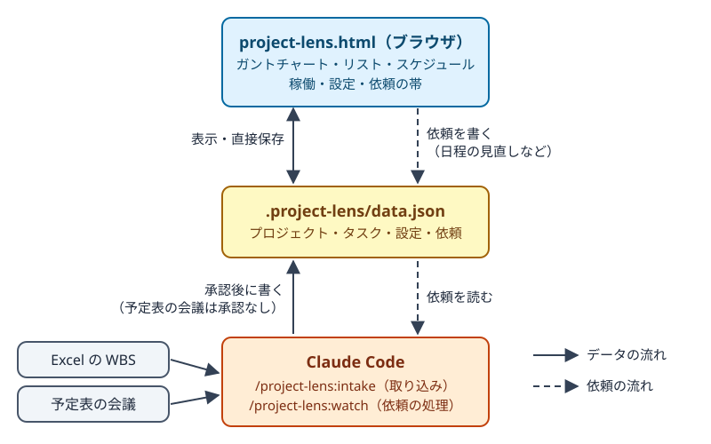
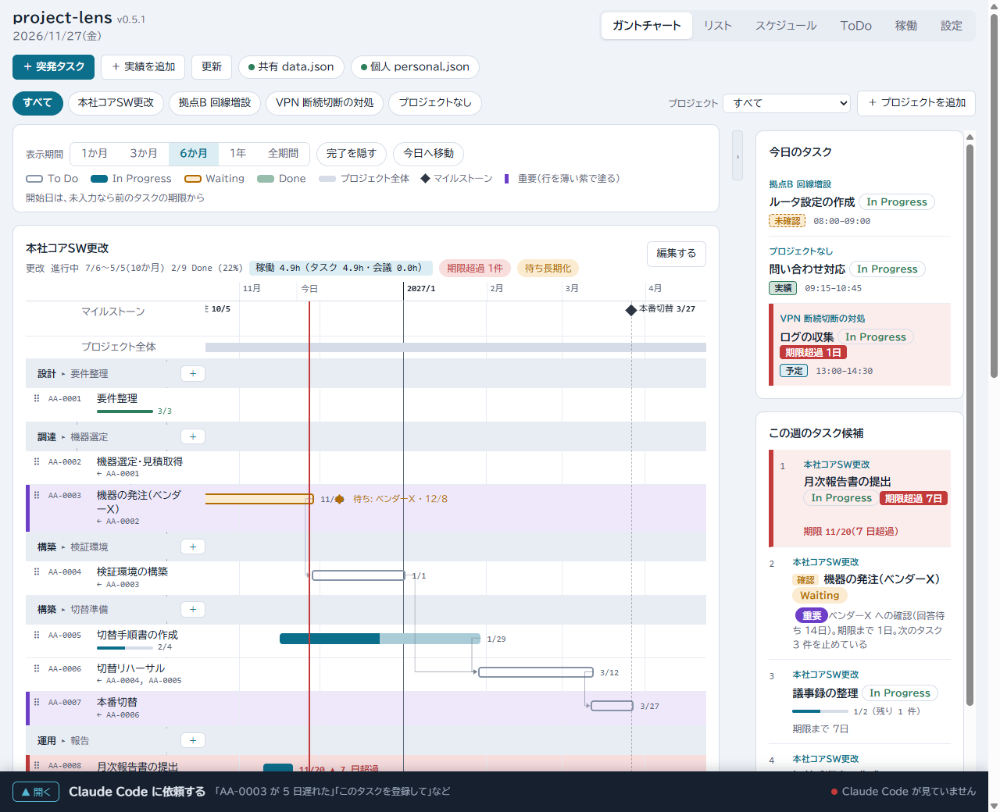
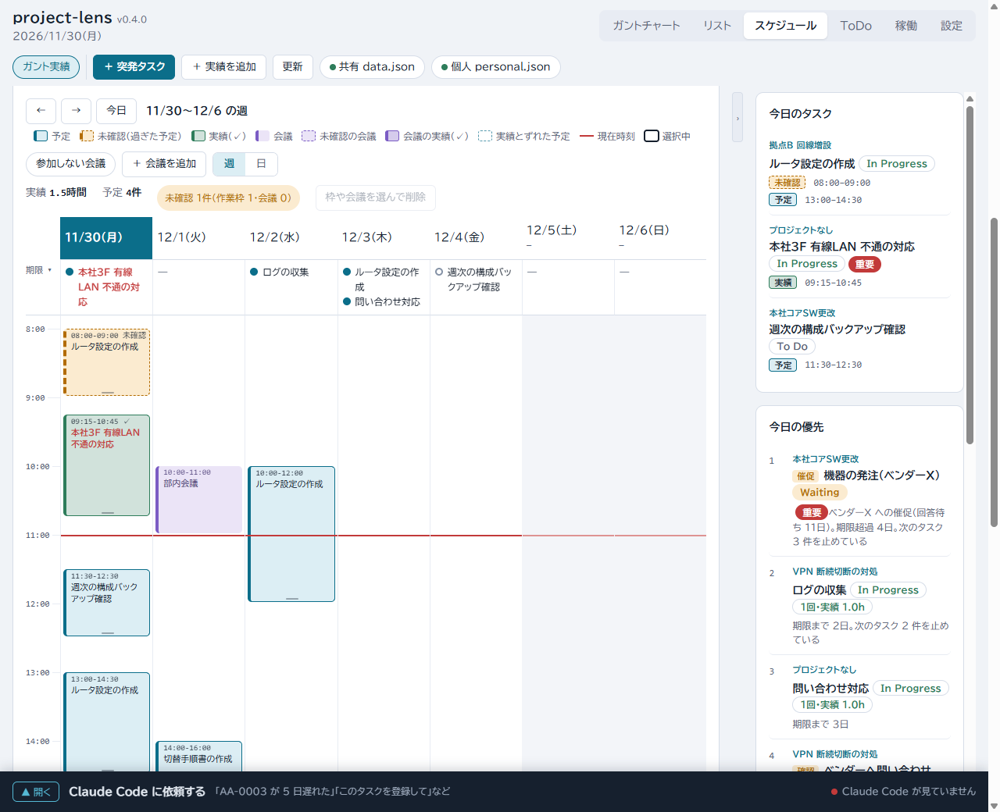
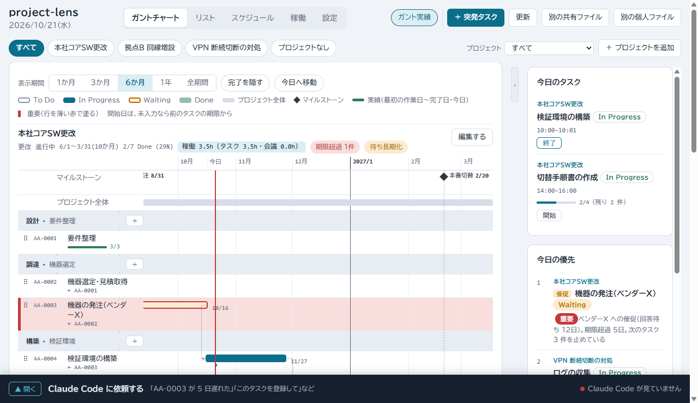
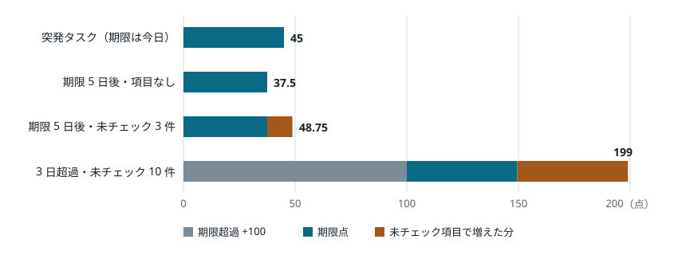
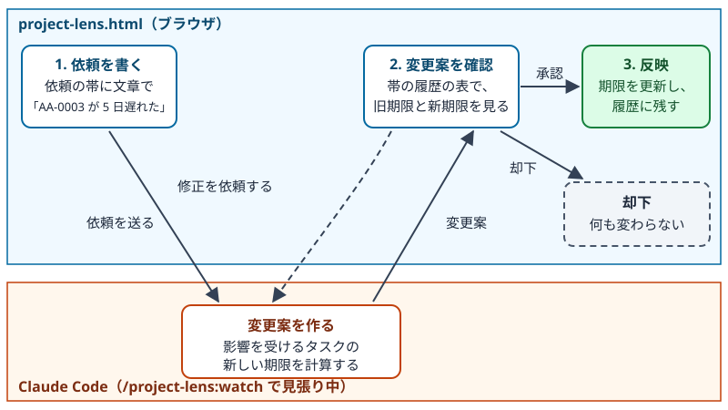
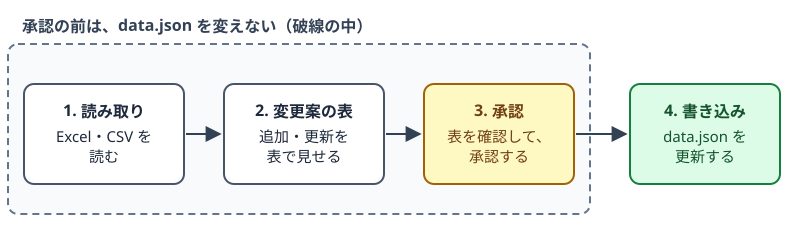

# project-lens 利用ガイド（詳細）

ネットワーク設備の管理者が、複数のプロジェクトと自分のタスクを 1 枚の画面で管理する Claude Code プラグインです（Windows 専用）。データは JSON ファイル 2 つ（共有の `.project-lens/data.json`（以下 `data.json`）と、個人の `.project-lens/personal.json`（以下 `personal.json`））、画面は HTML ファイル 1 つ（`project-lens.html`）です。画面の下端には、日程の変更などを Claude Code に頼む入力欄（依頼の帯）があります。

プラグインを入れたあと、プロジェクトのフォルダで Claude Code を開いて次を実行すると、架空のサンプルデータが入った画面が作られます。

```
/project-lens:init --sample
```



*図 1: 全体図。画面は 2 つのファイルを表示して、直接保存します。Excel・予定表の取り込みと、依頼の帯から届く依頼の処理は、Claude Code が受け持ちます。*

## 機能

| 機能 | できること |
|---|---|
| 一覧とこの週のタスク候補 | 複数プロジェクトの進捗をガントチャートとリストで見て、今日やるタスクを、点数で決めた順に並べます。重要なタスクには印を付けます。 |
| 日程の調整 | 1 つのタスクはバーのドラッグで、前後にまたがる変更は依頼の帯に文章で頼んで変えます。 |
| 突発タスクの登録 | 急に入った作業を、画面上部の「＋ 突発タスク」から、タスクと作業枠にします。 |
| 取り込み | Excel の WBS（作業分解表）と予定表（Outlook などのカレンダー）の会議を取り込みます。 |
| ToDo | 「ToDo」タブに、今日の枠があるタスク（今日の ToDo）と、その週のタスク（期限超過・その週に予定の枠がある・その週が期限・その週に完了）が自動で並びます。完了の入力欄で、実績・状態・チェックリストをまとめて保存します。週のタスクを「今日へ」（またはドラッグ）で今日の枠に入れることと、突発タスクの登録もできます。回答予定日を過ぎた `Waiting` のタスクは、「催促」の組に出て、「催促した」で次の回答予定日を決められます。手で登録する ToDo はありません。 |
| スケジュールと稼働 | タスクの作業枠（タスクに割り当てる時間帯）をスケジュールへドラッグで置き、やった時間を実績として入れて、日・週・月ごとにプロジェクト別の作業と会議の時間を集計します。稼働の画面では、期間ごとに、プロジェクト別のタスクの完了・進捗と、タスクごとの進捗・予定・実績の時間を見返せます。 |

- **この週のタスク候補**: 今週やるタスクを、点数の合計が高い順に並べます。決まり方は「優先順位の決まり方」を参照してください。
- **回答待ちの催促**: `Waiting` のタスクに回答予定日を入れると、過ぎたときに「この週のタスク候補」で催促として上がります。
- **定例タスク**: 編集の窓の「繰り返し」を毎週・毎月にすると、完了したときに次回のタスクを作ります。
- **重要**: リストの「重要」の列か編集の窓で印を付けると、点数に +12 され、ガントチャート・リストの行が赤い線と薄い赤で、「この週のタスク候補」「今日のタスク」は赤い「重要」の札で、スケジュールの枠は件名の赤い太字で示されます。

複数人で使えます。プロジェクトとタスクは、全員が同じ共有ファイル（`data.json`）を使い、作業枠・予定（会議）・休み・自分の特定・依頼は、各自の個人ファイル（`personal.json`）に置きます。共有ファイルは、ネットワークドライブや同期フォルダに置いて共有します（「導入方法」の SharePoint の項）。ロックはしないので、同じ瞬間に別の人が書くと、片方の編集が消えることがあります。他の人の稼働や、タスクの担当者は、表示しません。

## 導入方法

| 必要なもの | 内容 |
|---|---|
| OS | Windows |
| Claude Code | 必須です。 |
| Node.js | 24 以上が必須です。外部のパッケージは使いません。 |
| ブラウザ | Edge か Chrome が必要です（ファイルへの直接保存に使います）。 |
| Python 3.12 以上 | Excel の WBS を取り込むときだけ使い、標準ライブラリの venv と ensurepip が要ります。 |

venv は専用の仮想環境を作る機能、ensurepip は pip（Python のパッケージ入れ）を入れる機能です。

ネットワーク接続は、次の 4 つのときに使います。

- 導入（GitHub）。
- 祝日の取得（内閣府）。
- `/project-lens:doctor` の最新版の確認（GitHub）。
- Excel 用パッケージの取得（PyPI）。

足りないものは、`/project-lens:doctor` で調べられます（「動作環境の確認」を参照）。

### 1. プラグインを入れる

Claude Code で、次の 2 つを実行します。1 つ目で GitHub のリポジトリをマーケットプレイス（プラグインの配布元）として登録し、2 つ目でプラグインを入れます。

```
/plugin marketplace add asama0101/project-lens
/plugin install project-lens@project-lens
```

GitHub に接続できない環境では、リポジトリを持ち込んで、そのフォルダを登録します。

1. 別の環境で、`git clone https://github.com/asama0101/project-lens.git` を実行します。または、GitHub の「Code」→「Download ZIP」で取得します。
2. ZIP は展開し、`.claude-plugin` フォルダがある階層を使います。
3. そのフォルダを、媒体で持ち込みます。
4. 次の 2 つを実行します（`D:\tools\project-lens` に置いた例）。

```
/plugin marketplace add D:\tools\project-lens
/plugin install project-lens@project-lens
```

持ち込んだフォルダは、入れたあとも消さずに置きます。更新のときに読み直すためです。

### 2. 初回の準備

**すでに `project-lens.html` があると、新しい版に置き換わります。** 画面を手で直していたときは、実行の前に別の名前でコピーします。戻すときは、そのコピーを `project-lens.html` の名前に戻します。`data.json`・`personal.json` は変わりません。

管理したいプロジェクトのフォルダで Claude Code を開き、次を実行します。

```
/project-lens:init
```

試すだけなら、空の別フォルダで `--sample` を付けて実行します。プロジェクトのフォルダで `--sample` を実行すると、サンプルの `data.json`・`personal.json` ができ、あとで `--sample` なしで実行しても空のデータにはなりません（サンプルを消すときは、`.project-lens/` を削除します）。

`--sample` のとき、次のように出ます。

```
.project-lens/data.json: 作りました（サンプルデータ）
.project-lens/personal.json: 作りました（サンプルデータ）
project-lens.html: 作りました
.gitignore: 変更しませんでした（この場所も親のフォルダにも .git がないため、.gitignore は変更しません）

次の手順: ブラウザで project-lens.html を開き、「共有ファイルを選ぶ」で .project-lens/data.json、「個人ファイルを選ぶ」で .project-lens/personal.json を選びます。
```

1. `project-lens.html` を Edge か Chrome で開き、「共有ファイルを選ぶ」で `.project-lens/data.json`、「個人ファイルを選ぶ」で `.project-lens/personal.json` を選びます。2 つとも選ぶと、画面が開きます。以後、画面での変更は、変えた方のファイルに直接保存されます。
2. 「＋ プロジェクトを追加」から、プロジェクトを登録します。タスクは、ガントチャートとリストの見出し行の「＋」で足します。

複数人で使うときは、最初の 1 人が `/project-lens:init` で共有ファイル（`data.json`）を作り、ネットワークドライブなどの全員が開ける場所へ置きます。ほかの人は、自分の作業フォルダで `/project-lens:init` を実行して、自分の個人ファイル（`personal.json`）を作り、共有ファイルを「共有ファイルを選ぶ」で選びます（共有ファイルの場所が変わっても、個人ファイルは変わりません）。個人ファイルを `.project-lens/` 以外に置くときは、`/project-lens:init --mine <ファイル>` を実行します。以後の Claude Code のコマンド（取り込み・見張りなど）も、個人ファイルが既定の場所（共有ファイルと同じフォルダの `personal.json`）にないときは、同じ `--mine <ファイル>` を付けて実行します。

次回からは、`project-lens.html` を開くだけで、前回の 2 つのファイルが開きます。アクセス許可の確認が出たときは、開始画面の「前回のファイル（ファイル名）を開く」を押します。いま、どのファイルを開いているかは、ヘッダーの札で確かめます。

- `.git` があるフォルダでは、`.gitignore` に `.project-lens/` を追記します（UTF-8 の `.gitignore` だけ）。`--mine` で `.project-lens/` の外に置いた個人ファイルは、除外されません。個人ファイルには、自分のメールアドレス（`selfEmails`）などが入るので、git で管理しないよう、自分で `.gitignore` に足してください。
- サンプルの日付は 2026 年 6 月〜2027 年 3 月です。開いた日によっては、期限超過が多く出ます。ブラウザのアドレス欄に出る `file:///` から始まる `project-lens.html` のパスの末尾に `?today=2026-10-20` を付けて開くと、その日を今日として表示します（ダブルクリックでは付けられません）。

<details>
<summary>SharePoint Online に置いた共有ファイルを使う（動作は未確認）</summary>

複数人で使うときは、共有ファイル（`data.json`）だけを SharePoint Online のドキュメントライブラリに置き、ネットワークドライブに割り当てる（または同期したフォルダにする）と、全員が同じ共有ファイルを開けます。そこの `data.json` を「共有ファイルを選ぶ」で選びます（https の URL は指定できません）。個人ファイル（`personal.json`）は、各自の手元に置き、「個人ファイルを選ぶ」で選びます。**この方法は、動作を確かめていません。** 先に `data.json` のコピーで試します。画面での編集と保存だけを想定しています。取り込みと `/project-lens:watch` が、このドライブの `data.json` を扱えるかは、確かめていません。同期が遅れると、共有ファイルにまだ届いていないタスクの作業枠について、「共有ファイルに無いタスクの作業枠が N 件あります」と出ることがあります。同期が済んだあとに「更新」を押して、消えるかを確かめてから、「該当の枠を削除」を押します。

</details>

### 更新

更新の前に、`project-lens.html` を別の名前でコピーします（`init` は、コピーを作りません）。Claude Code の `/plugin` 画面で、project-lens を更新します。持ち込んだフォルダから入れたときは、先にそのフォルダを新しい版に差し替えます。そのあと、使っている作業フォルダごとに `/project-lens:init` を実行します。`project-lens.html` だけが新しい版になり、`data.json`・`personal.json` は変わりません。

### 動作環境の確認

別の PC で使い始めるときや、動かないときは、Claude Code で `/project-lens:doctor` を実行します。次の 7 項目を調べて、足りないものと対処の手順を表示します。何も変更しません。

| 項目 | 調べること | 区分 |
|---|---|---|
| OS | Windows であること | 必須 |
| 実行環境 | Node.js が 24 以上であること | 必須 |
| 保存先 | 書き込めるフォルダであること | 必須 |
| 祝日一覧 | 内閣府へ接続できること | 任意 |
| Excel の読み取り | Python・pip・openpyxl（Excel を読む Python ライブラリ）が使えること | 任意 |
| 予定表の MCP の指定 | 予定表につなぐ MCP が指定してあること | 任意 |
| プラグインのバージョン | 今の版を表示し、GitHub から入れたときは最新版か確認すること | 情報 |

MCP は、Claude Code が外部のツール（予定表など）に接続する仕組みです。保存先は、プラグインのデータを置くフォルダです。

項目ごとに `[OK]`・`[NG]`・`[任意]`・`[情報]` と、`→` で始まる対処の手順が出ます。必須の項目が足りないと、終了コード 3 で終わります。任意の項目だけが足りないときは、0 です。

Claude Code を使わずに、コマンドプロンプトで実行するときは、次のようにします（`<版>` は、`cache\project-lens\project-lens` の下にあるフォルダの名前です）。PowerShell では、`%USERPROFILE%` を `$env:USERPROFILE` に替えます。

```
node "%USERPROFILE%\.claude\plugins\cache\project-lens\project-lens\<版>/tools/doctor.js" --data "%USERPROFILE%\.claude\plugins\data\project-lens-project-lens"
```

環境変数 `PROJECT_LENS_HOME` を設定しているときは、`--data` より優先されて、そのフォルダが保存先になります。

### アンインストール

**プラグインを削除すると、保存先（`%USERPROFILE%\.claude\plugins\data\project-lens-project-lens`）が消えます。** 消えるのは、Excel 用の Python パッケージを入れた専用の venv（`venv` フォルダ）と、予定表の MCP の指定 `project-lens-mcp.json` です。

保存先ごと削除するときは、Claude Code で次を実行します。

```
/plugin uninstall project-lens@project-lens
```

保存先を残して削除するときは、ターミナルで次を実行します。

```
claude plugin uninstall project-lens@project-lens --keep-data
```

作業フォルダの `.project-lens/data.json`・`personal.json`、`.project-lens/data.json.bak`・`personal.json.bak`（コマンドでの直前の保存の前の版）、`project-lens.html` は残ります。システムの Python のユーザー領域に入れた openpyxl も残ります（`pip uninstall openpyxl` で消せます）。保存先を消したあとで再インストールしたときは、`venv` を Excel の取り込み時の承認で、MCP の指定を `/project-lens:mcp` で、作り直します。

## 使い方

| 流れ | Claude Code | いつ使うか |
|---|---|---|
| 毎朝の流れ | 使わない | 今日やることを決めて、やった時間を実績にする |
| 突発タスクの追加 | 使わない | 急に入った作業を、時間枠つきで登録する |
| 依頼の帯から頼む | `/project-lens:watch` を実行しておく | 外部要因で日程が動いた、タスクを足したい |
| 取り込み | `/project-lens:intake` を使う | Excel の WBS・予定表の会議を入れる |

最初の例（コマンドと出力）は、「初回の準備」にあります。コマンドの実行時に、Claude Code が許可を確認することがあります。このプラグインのコマンドなので、許可して構いません。

### 毎朝の流れ

画面を開いて、今日やることを決め、やった時間を実績として入れます。次の 3 枚の画像は、画像のために作った架空のデモデータ（`--sample` のサンプルデータとは別のもの）を、ファイル選択を差し替えて開いた画面です。日付は 2026-11-30、時刻は 11:20 に固定しました（URL の末尾の `?today=2026-11-30&time=11:20`）。08:00〜09:00 の「ルータ設定の作成」の枠は、時刻を過ぎた予定なので「未確認」の札が付いています。2 枚目は「週次の構成バックアップ確認」を今日の 11:30 へドラッグしたあと、3 枚目は「ルータ設定の作成」の 08:00〜09:00 を実績にしたあとです。3 枚目の画像は、旧い画面のまま（未更新）で、実績を入れた枠が実績の時刻の 1 つのブロックになる今のカレンダーと、行の「予定 HH:MM–HH:MM」の添え書きは写っていません。

1. **「この週のタスク候補」を見る。** ガントチャートとリストの右側に、今週の未完了のタスクが、優先順（点数の高い順）に並びます（スケジュール画面も同じです）。「今日のタスク」には、今日に作業枠があるタスクが並びます。

   

2. **今日やるタスクを、時間枠に置く。** 「スケジュール」で、「この週のタスク候補」のタスクを今日の列へドラッグします（15 分刻み）。置いた枠は 1 時間の予定（今より前の時間に置いても予定）で、枠の端をつかんで長さを変えます。置いたタスクは、「今日のタスク」に出ます。同じタスクをもう 1 つ置くときは、「今日のタスク」の行をカレンダーへドラッグします。

   

3. **やった時間を、実績として入れる。** 「スケジュール」で、始まった予定の枠（過ぎた予定の「未確認」を含む）を押すと、実績の入力欄が、開始・終了に予定の時刻が入った状態で出ます。日付・開始・終了をやった時間に直して「実績を保存」を押すと、その予定の枠に実績が付き（予定の時刻は変わりません。カレンダーでは、その枠が実績の時刻の緑のブロック 1 つ（✓ 付き）になり、予定と時刻がずれていれば、予定の時刻に点線の影が残ります。実績が付いた予定は、未確認でなくなります）、To Do・Waiting のタスクは In Progress に変わります。実績のある枠を選ぶと「実績を更新」「実績を消す」が出ます（消しても予定の枠は残ります）。実績のある枠は、ドラッグで動かせません。予定を動かすときは、先に「実績を消す」を押します。実績のある枠を削除するときは、「実績 N 分も消えます」の確認が出ます。予定にない作業は、ヘッダーの「＋ 実績を追加」で、タスク・日付・開始・終了を入れて足します。会議は、会議を押すと、予定の枠と同じ形の実績の欄（日付は会議の日付）が出るので、開始・終了を入れて「実績を保存」を押します（実績の時刻の濃い色のブロック 1 つになります。「実績を消す」で、未確認に戻せます）。終わったタスクは、リストなどの状態の欄で Done にします。チェックリストに未完了の項目が残っていると、「残りをすべてチェックして Done にする」か「やめる」を選ぶ警告が出ます（要らない項目は、削除してから Done にします）。変更は、その場で保存されます。

   

### 優先順位の決まり方

点数の合計が高い順に並べます。画面に出るのは、順位と理由（「期限まで N日」「回答予定日を過ぎています」など）だけで、点数は出しません。

載るのは、`Done`・`Cancelled` 以外のタスクです。前のタスクが未完了のタスクも載り、理由の先頭に「前のタスク待ち」と出ます（点数は変わりません）。開始日は見ません。プロジェクトなしのタスクも、同じ点数で載ります。

| 項目 | 点数 |
|---|---|
| 期限超過 | +100 |
| 期限点 | 残り 30 日以内は (30 − 残り日数) × 1.5。超過した日数の分も加算します。残り 31 日以上は 0 |
| チェックリストの倍率 | 期限点に 1 + min(未チェックの項目数, 10) ÷ 10 をかけます（最大 2.0）。`Waiting` はかけません。+100 と重要にもかけません |
| 重要 | 重要の印（`important`）があれば +12。倍率のあとに足します |
| 回答予定日の超過 | `Waiting` で回答予定日が今日より前なら +40（倍率なし）。行の文言は「催促」になります |



*図 2: 点数の計算例（重要なし）。突発タスクは、今日の日付で登録した場合です。*

- 同点のときは、期限の早い順、次に ID の順です。
- 「次のタスクを止めている件数」は、行の理由に出すだけで、点数には入れません。
- 回答予定日の +40 の使い心地は、確かめていません（未確認）。

### 登録できる内容

データは、プロジェクト・タスク・会議・設定の 4 種類です。

| 種類 | 登録できる項目 | 登録の経路 |
|---|---|---|
| プロジェクト | 名前・種別（増設／更改／改善／不具合対処／その他）・状態（計画中／進行中／保留／完了／中止）・開始日・期限・マイルストーン（名前と日付） | 画面の「＋ プロジェクトを追加」 |
| タスク | 件名・期限・開始日（任意）・状態・メモ・大項目／中項目・前のタスク・重要（印）・チェックリスト・待ち先・繰り返し | 画面の「＋」、Excel の WBS の取り込み、依頼の帯 |
| 作業枠 | タスクごとの日付・開始／終了時刻・種別（予定／実績）。予定の枠は、やった時間の実績（日付・開始・終了）を持てます | 画面のスケジュール |
| 会議 | 日付・開始／終了時刻・件名・所属プロジェクト・確認済みか | 予定表の取り込み |
| 日程変更の履歴 | 変更前後の期限・原因（ベンダー／社内／自分／その他）・理由 | 依頼の承認、取り込み |
| 設定 | 営業日の数え方・待ち長期化の日数・見出しの呼び名・休み・会議名の規則 | 画面の「設定」タブ |

タスクは、プロジェクトに属さなくても登録できます（プロジェクトなし）。

| 経路 | できること | 承認 |
|---|---|---|
| 画面 | すべての項目の登録・編集・削除 | 不要（その場で保存） |
| 依頼の帯 | タスクの登録と、期限の変更だけ | 必要 |
| Excel の WBS | タスクの一括登録（CSV も可） | 必要 |
| 予定表 | 会議の登録・更新 | 不要 |

<details>
<summary>タスクの項目の意味</summary>

| 項目 | 内容 |
|---|---|
| 状態 | `To Do`・`In Progress`・`Waiting`・`Done`・`Cancelled` の 5 つです。 |
| 前のタスク | 先に終わらせるタスクです。循環させると保存できません。 |
| 開始日 | 任意です。指定したタスクは、前のタスクの期限が変わっても動きません。 |
| 待ち先 | `Waiting` のとき、相手・待ち始めた日・回答予定日を入れます。 |
| チェックリスト | 未チェックの数が、優先順位の点数に入ります。 |
| 繰り返し | 毎週、または毎月（1〜31 日）です。完了すると、次回のタスクを作ります。 |
| 重要 | 印を付けるか、付けないかの 2 つだけです。Excel の WBS の取り込みでは付きません（取り込んだあとに画面で付けます）。 |

</details>

### 依頼の帯から頼む

前後のタスクにまたがる変更（外部要因で日程が動いたとき）は、画面下端の依頼の帯（「Claude Code に依頼する」）に文章で頼みます。



*図 3: 依頼の帯から日程を変える流れ。*

1. `project-lens.html` のあるフォルダで Claude Code を開き、`/project-lens:watch` を 1 回実行して、見張りを始めます。見張りは、Claude Code が依頼の帯への依頼を待ち受ける状態で、その間、帯に「Claude Code が見ています」と出ます。
2. 帯を開いて、プロジェクトを選び、依頼を書いて「依頼を送る」を押します（例: `AA-0003 が 5 日遅れた（原因: ベンダー）`）。
3. 数秒で、帯の履歴に変更案の表が出ます。確認して「承認して反映する」を押します。「却下する」も選べます。違うときは、承認の前に「修正を依頼する」で伝えます。

サンプルデータの変更案は、次の表になります。次のタスクの AA-0004 は、期限に余裕があるので動きません。

| ID | 件名 | 旧期限 | 新期限 | 理由 |
|---|---|---|---|---|
| AA-0003 | 機器の発注（ベンダーX） | 10/16 | 10/21 | 指定（+5日） |

- **「承認して反映する」を押すまで、タスクの期限は変わりません。** 依頼の記録だけが、個人ファイル（`personal.json`）に書かれます。
- 承認すると、期限が更新され、原因と理由が日程変更の履歴に残ります。承認は、`/project-lens:watch` を動かしている端末での「R3 を承認」（R3 は依頼の番号）でもできます。
- 日程変更の履歴は、リストの各プロジェクトの「日程変更の履歴」に出ます。画面で期限を直接変えたときは、記録されません。
- Claude Code がデータを直すと、画面が自動で読み直します（帯を開いている間と依頼の処理中は 4 秒ごと、それ以外は 16 秒ごと）。すぐに見たいときは、画面上部の「更新」を押します。
- 見張りは 30 分ごとに終わり、Claude Code が自動で張り直します。帯が「見ていません」になったときは、`/project-lens:watch` をもう一度実行します。止めるときは、Claude Code に「見張りをやめて」と伝えます。

#### 依頼で頼めること・頼めないこと

頼めるのは、**タスクの登録**と**期限の変更（遅れ・前倒し）**の 2 種類だけです。

| 区分 | 内容 |
|---|---|
| 頼める: 登録 | 文章から、タスクを 1 件以上登録します。プロジェクトの指定が必須です。大項目・中項目・期限・前のタスク・チェックリストの項目も指定できます。期限が書かれていないときは、前のタスクから営業日で仮に置きます。件数や中身が書かれていないときは、作業の性質から 3〜5 件の案を作ります。 |
| 頼める: 期限の変更 | 遅れた・前倒しになった日数（または新しい期限）を、文章で伝えます。遅れたときは、次のタスクを必要な分だけ連鎖して動かします（期限に余裕があるタスクは動きません）。前倒しのときは、次のタスクも詰める依頼のときだけ詰めます。原因と理由を、日程変更の履歴に残します。 |
| 画面で行う | 状態・重要の変更、削除、プロジェクトの追加と変更、マイルストーン、チェックリストの項目の変更、前のタスクの付け外し、待ち先の設定。 |
| 受けない | メール・議事録・メモの本文の取り込み。 |

できないことだけを頼むと、Claude Code は変更案を作らず、「この依頼は画面で行ってください」と返します。できることと混ざった依頼は、できる分だけ提案し、残りは画面で行うよう添えます。

<details>
<summary>依頼の制限</summary>

- `/project-lens:watch` を実行している間だけ処理されます。見張りが止まっている間、依頼は処理されません。
- 承認の前に、提案のあとでデータが変わると、反映せず依頼が「失敗」になります。「もう一度提案してもらう」で作り直します。
- 期限の移動と、営業日で期限を置くタスクの登録は、同じ依頼にできません。期限の移動を先に承認し、登録は、もう一度頼みます（日付を指定した登録は、一緒にできます）。
- 原因は、1 回の依頼に 1 つです。複数あるときは「その他」にします。
- 開始日を指定したタスクは、前のタスクの期限が変わっても動きません。
- プロジェクトなしのタスクは、登録できません（プロジェクトの指定が必須のため）。画面は、プロジェクトなしのタスクに前のタスクを付けさせないので、通常は、期限の移動で動きません。`data.json` を手で直して前のタスクを付けたときだけ、その前のタスクが遅れると、連鎖して動きます。
- 新しい期限が、休みの日・今日より前・前のタスクの期限より前のときは、警告を出します（提案は止めません）。
- 1 件の依頼は 4000 文字までです。依頼の履歴は最新の 20 件で、超えると、反映・却下・失敗した古いものから消え、処理中のものは消えません。

</details>

### 突発タスクの追加

急に入った作業は、画面上部の「＋ 突発タスク」を押して登録します（カレンダーを押して開く方法はありません）。画面だけで完結し、承認と見張りは要りません。登録すると、タスクと作業枠を 1 回の保存で作ります。

1. 画面上部の「＋ 突発タスク」を押します（どの画面でも出ます）。スケジュール画面に移り、入力欄が開いて、件名にカーソルが入ります。日付と開始が入っています。ToDo タブでは、画面を移らず、左の「今日の ToDo」の上に入力欄が開きます（左の列の見出しの横の「＋ 突発タスク」も同じです）。登録したあとも ToDo タブのままで、今日の枠なら左の列に出ます。
2. 件名・プロジェクト（既定は「プロジェクトなし」）・長さ（15・30・45・60 分。初期値 30）を入れます。日付（`2026/10/20` などと打つか、「📅」で選ぶ）と開始（15 分刻み）も変えられます。
3. Enter か「追加」を押します。Esc・欄の外のクリック・「キャンセル」では、何も作らずに閉じます。

| 作られるもの | 値 |
|---|---|
| タスク | 期限・開始日は、入力欄の日付。状態は `In Progress`。 |
| 作業枠 | 入力欄の開始から、選んだ長さの分。種別は予定です（今より前の時間でも予定で、過ぎた予定は、重なる実績が無ければ「未確認」として出ます。実績は、予定の枠を選んで入れます）。 |

**制限事項**

- 緊急の印・点数はありません。通常のタスクと同じ規則で点数が付きます。今日に登録すると 45 です（図 2）。サンプルデータで今日を 2026-10-21 にして実行すると、AA-0003（164.5）に次ぐ 2 位で、期限まで 1 日の AC-0001（43.5）より上でした。明日の日付なら 43.5 で、期限の翌日からは、期限超過で +100 が付きます。
- 枠が今日にあるので、「今日のタスク」に載り、「この週のタスク候補」の一覧からは外れます。
- 件名が空のときは、何も作らず、欄が開いたままです。日本語入力の変換確定の Enter では確定しません。
- 枠を置けないとき（休みの日・ほかの枠との重なりなど）は、タスクも作らず、エラーを出して欄を残します。会議と重なるときは、警告つきで作ります。
- 今日以外の日でも登録できます（日付の欄で変えます）。「今日のタスク」には、枠が今日のときだけ載ります。
- プロジェクトなしのタスクは、ガントチャート・リストに「プロジェクトなし」の区切りで出ます。リストの区切りに「＋」は出ません。プロジェクトとの付け替えは、前のタスクがあるときは拒否します。

### 取り込み

`/project-lens:intake` で、Excel の WBS・予定表の会議・会議のプロジェクト規則を取り込みます。Excel の WBS と規則は、次の順で進み、承認の前は、データを変えません。



*図 4: Excel の WBS と規則の取り込みの流れ。*

予定表の会議だけは、承認の確認なしで更新します（終わった会議と確認済みの会議は変えません）。`/project-lens:intake` は、自分で入力したときだけ動きます（「予定表を取り込んで」と頼んでも、自動では起動しません）。

| コマンド | 内容 |
|---|---|
| `/project-lens:intake wbs <ファイル> [プロジェクト]` | Excel（または CSV）の WBS を、タスクとして取り込みます。 |
| `/project-lens:intake calendar [期間]` | 予定表の会議を取り込みます。 |
| `/project-lens:intake rules` | 会議のプロジェクト規則（件名のキーワードとプロジェクトの対応）を見る・変えます。 |

`calendar` は、先に `/project-lens:mcp` で、使う MCP（例: Outlook）を指定します。

#### Excel 用の Python ライブラリ

Excel の WBS を取り込むときだけ、openpyxl が要ります。システムの Python に openpyxl が入っていれば、それを使います。入っていなければ、承認すると自動で入ります。入れ先は、専用の venv（推奨。システムの Python を変えない）か、システムのユーザー領域（`pip install --user`）から選びます。

入れたくないときは、Excel を「CSV UTF-8（コンマ区切り）」で保存して取り込みます。Python は要りません。CSV では結合セルなどの情報が失われるので、階層は大項目・中項目の列に書きます。この Python に venv と ensurepip が無いときは、venv を作れないので、システムに入れるか、CSV に保存します。

<details>
<summary>予定表の取り込みの詳細</summary>

- 予定表の MCP は、このプラグインに同梱していません。先に Claude Code に用意して、`/project-lens:mcp` で指定します。
- `/project-lens:intake calendar` と、見張りの間の自動更新は、承認の確認なしで、追加と、終わっていない未確認の会議の更新・削除をします。今日より前の会議は取り込みません（取り込み済みのものは変えません）。結果は「追加 N・更新 N・削除 N・対象外 N・保留 N」の 1 行で出ます。
- 取得が 0 件のとき、または取得に無い会議が多すぎるときは、削除しません。`/project-lens:intake calendar` では、消える会議の一覧を見せて、削除してよいかを聞きます。
- 終日の予定（休暇・出張など）は取り込まないので、その日のカレンダーには出ません（作業枠は置けます）。
- 自分だけの予定と、自分と会議室だけの予定は、会議として取り込みません。判定のために、`/project-lens:mcp` で自分のメールアドレスを設定します（未設定のときは、何も除きません）。

</details>

### コマンド一覧

| コマンド | 使いどころ |
|---|---|
| `/project-lens:doctor` | 動作環境の診断（足りないものと対処を表示する。何も変更しない） |
| `/project-lens:init` | セットアップ（`--sample` でサンプルデータ入り） |
| `/project-lens:intake` | Excel の WBS・予定表の会議の取り込み、会議のプロジェクト規則 |
| `/project-lens:mcp` | 予定表で使う MCP の指定（`show` を付けると表示だけ） |
| `/project-lens:watch` | 見張りを始めて、依頼の帯から届く依頼を処理する |

### 画面の見方

画面上部のヘッダーには、タイトルと版の表記（`v` で始まる番号）、ガントチャート・リスト・スケジュール・ToDo・稼働・設定の 6 つのタブ、「＋ 突発タスク」などのボタン、読み込み中の共有ファイルと個人ファイルの札があります。札を押すと、ファイル名・中身の手がかり・更新日時・書き込めるか（「書き込めます」か「読み込み専用」）の詳細が開き、「別の共有ファイルを選ぶ」・「別の個人ファイルを選ぶ」で、選んだ方のファイルだけを差し替えられます。詳細は、もう一度札を押す、外を押す、Escape、タブを移るのどれかで閉じます。フォルダの場所は、ブラウザが渡さないので出ません。ヘッダーは、どのタブでも、下へスクロールしても上に固定されます。

| 画面 | 内容 |
|---|---|
| ガントチャート | プロジェクトで絞り込み、プロジェクトごとのカードで、タスクの期間をバーで見ます。行の頭に ID（`AA-0001` など）が出ます。状態が `Waiting` で待ち先のあるタスクには、バーの横に「待ち: 待ち先 ・ 回答予定日」が出て、回答予定日に ◆ が付きます。回答予定日が今日より前だと赤になり、「超過」と出ます。 |
| リスト | ガントチャートと同じ絞り込みで、タスクを表で見て編集します。「繰り返し」の列で、毎週・毎月の定例を指定できます。 |
| スケジュール | 週／日の 0〜24 時の枠（開くと 08:00 から表示）に、タスクの作業枠と会議を置きます。週表示では、日付の下に、その日が期限のタスクの行（「期限 ▾」で開閉）が出ます。今日の日付は塗りつぶしで示し、赤い現在時刻の線を引き（週表示では、週の全部の列に同じ線を引きます）、いま進行中の枠・会議に「いま」を付けます。ID は出さず、件名だけで表します。 |
| ToDo | 左の「今日の ToDo」に、スケジュールの今日の枠があるタスクを、今日の枠の札（予定・未確認・実績）と時刻つきで並べます。右の「この週のタスク候補」に、表示中の週の未完了のタスク（期限超過・今週に予定あり・今週の期限）を、右の列と同じ順に 1 つの一覧で並べ、各行に理由（「期限超過 3日」「重要」「今週に予定あり」など）を添えます。完了したタスクは、末尾の「完了」の組に出ます（タスクの期限・状態・作業枠から自動で決まり、手で足す・外すことはしません。Cancelled のタスクは出ません）。行には、プロジェクト名・件名・状態・期限・チェックの進捗・その週の予定と実績の分が出て、前のタスクが未完了のタスクには「前のタスク待ち」が付きます。「完了」を押すと、その行に入力欄が開き、実績（日付・開始・終了。省略できます）・状態（初期値は Done）・チェックリスト（「残りをすべてチェック」もあります）を、「保存」でまとめて保存します。状態が Done のときは、未完了の項目が残っていると保存できません（「残りをすべてチェック」でチェックするか、要らない項目を「×」で消してから保存します）。1 つでも保存できない内容があると、何も保存せず、入力は欄に残ります。入力欄では、チェックリストの項目を「×」で消し、「＋ 項目を追加（Enter）」で足せます。項目の追加・削除は、その場でタスクに保存されます（チェックの付け外しは「保存」のときです）。右の列の未完了の行の「今日へ」を押すと、その行に入力欄（開始・長さ。初期値は、今を 15 分刻みに切り上げた時刻から 60 分）が開き、「今日に入れる」で、今日の予定の枠を足します（そのタスクが左の列に出ます）。休みの日や、ほかの枠と重なる時刻では入らず、入力は欄に残ります。右の列の行を、左の「今日の ToDo」へドラッグして離しても、同じ入力欄が開きます。左の列の見出しの横の「＋ 突発タスク」で、画面を移らずに突発タスクを登録できます。左の列の「今日の ToDo」の下には、`Waiting` のタスクのうち、回答予定日を過ぎたもの（回答予定日がなければ、待ち始めから `waitingLongDays` 日以上たったもの）が「催促（N 件）」の組に出ます。「催促した」を押すと、次の回答予定日（1・2・3・5・7 日後）を選んで「記録する」で、待ち始めを今日、回答予定日をその日にします。「待ち先・予定日を直す」では、待ち先と回答予定日を直せます。催促の組は、優先順位の点数には影響しません。ガントチャート・リストの「この週のタスク候補」の未完了の行の「今日へ」を押すと、ToDo タブへ移って、同じ「今日へ」の入力欄が開きます（スケジュール画面では、ドラッグで置きます）。右の列の ←・→・「今週」で、右の列の週を動かします。期間ごとのタスクの見返しは、稼働タブにあります。 |
| 稼働 | 日／週／月ごとに、プロジェクト別のタスクと会議の時間を集計します。開いたときは、今日の分（日）を表示します。プロジェクト別の表には、その期間のタスクの「完了」（Done の件数 / 件数）と「進捗」の棒も出ます。下の「タスク」の表には、その期間に予定・実績・期限があるタスクを、プロジェクト・進捗・予定と実績の分で並べます。期限が過ぎて未完了のタスクは、どの期間でも載ります。 |
| 設定 | 営業日の数え方・日本の祝日・休み・会議名のキーワード規則を扱います。 |

稼働は、実績の時間（予定の枠に入れた実績と、実績だけの枠）と、確認済みの会議だけを数えます（会議は、実績の時間があればその時間）。スケジュールの過ぎた予定の枠・会議は、実績を入れると数えられます。予定の時間と実績の時間は重なって構いません（実績どうし、予定どうしは重ねられません）。

- ガントチャートのバーは、左端のドラッグで開始日、右端で期限、中ほどで両方を動かします。前後のタスクは確認せず、そのタスクだけが動きます。
- タスク名かバーをクリックすると、編集の窓が開きます。スケジュールでは、枠を押すと、カレンダーの上にそのタスクの編集欄が開きます。状態が `Waiting` のときは、どちらにも「待ち先」「回答予定日」の欄が出ます（回答予定日は、待ち先を入れてから入れます）。
- スケジュールの上の行に、色の凡例（予定・未確認・実績・会議・会議の実績・実績とずれた予定・現在時刻など）が並びます。
- 日付の欄は、`2026/10/20`・`2026-10-20`・`20261020`・`2026年10月20日` のどれでも打てます。横の「📅」で、カレンダーからも選べます。読めない日付は、元の値に戻ります。
- ガントチャートとリストの行頭の「⠿」をドラッグすると、タスクの並びを変えます。別の大項目・中項目の行へ落とすと、そのタスクの大項目・中項目も付け替わります（同じプロジェクトの中だけ）。

## 設定

「設定」タブで変えると、その場で保存されます。休み・営業日の指定・自分の特定は `personal.json`、ほかの設定は `data.json` の `settings` です。`settings` に、直接書くこともできます。省略した項目は、既定値になります。形が違う値には、「設定」タブの項目の横に注意が出ます。

| 項目 | 内容 | 既定 |
|---|---|---|
| `countWeekendsAndHolidays` | `true` のとき、土日と日本の祝日を営業日として数える | `false` |
| `waitingLongDays` | `Waiting` を「待ち長期化」とみなす日数 | 7 |
| `labels` | 見出しの呼び名（`group`・`subgroup`） | 大項目・中項目 |
| `projectRules` | 会議のプロジェクト規則（`keyword`・`projectId`） | なし |
| `holidays` | 手動の休み（`date`・`kind`＝祝日／有給／その他・`note`） | なし |
| `workdays` | 営業日として扱う日（`date`・`note`）。例: 休日出勤 | なし |
| `nationalHolidays` | 取得した日本の祝日（自動で取得します） | なし |

営業日の計算とスケジュールの作業枠は、土日・日本の祝日・手動の休みを飛ばします。`nationalHolidays` は、営業日で期限を置く依頼のときと `/project-lens:watch` を始めるときに、未取得・古い・範囲外なら、内閣府の祝日一覧から自動で取得します。

直接書くときの例です。

```json
"settings": {
  "waitingLongDays": 5,
  "labels": { "group": "フェーズ", "subgroup": "作業" },
  "projectRules": [{ "keyword": "ベンダーX", "projectId": "AA" }]
}
```

## 困ったとき

| 画面や端末に出る症状 | 対処 |
|---|---|
| 保存時に「他で更新されました。再読込してください」と出る | 他の手段で `data.json` か `personal.json` が更新されました。下の注意を読んでから、バナーの「再読込」を押します。 |
| 「前回のファイルの記憶を読めませんでした」と出る。毎回ファイルを選ぶ必要がある | このブラウザが記憶を許していません。通常のウィンドウで開きます。 |
| 「このブラウザはファイルへの直接保存に対応していません。読み込みだけできます」と出る | Edge か Chrome で開きます。ほかのブラウザでは、共有ファイルと個人ファイルを一度に 2 つ選んで開き、保存は「JSON を書き出す」（2 つのファイルがダウンロードされます）で行います（動作は、Chromium で確認しただけです）。 |
| `/project-lens:init` が「何も変更せずに止めました」と出る | 同名の別の `project-lens.html` があります。名前を変えるか移動してから、もう一度実行します。 |
| 帯が「見ていません」になっている | `/project-lens:watch` を実行します。 |
| 読み込み時に「注意: settings.…」と出る | `settings` の値の形が違います。「設定」タブか `data.json` で、「設定」の書式に合わせて直します。 |
| 「Excel を読むための openpyxl が、システムの Python にも専用の venv にもありません」と出る | 入れ先を選んで承認するか、Excel を CSV に保存して取り込みます。 |
| `/project-lens:doctor` に `[NG]` と出る。別の PC で動かない | `→` で始まる手順に、上から従います。 |

- 「前回のファイルの記憶を読めませんでした」は、シークレットウィンドウや、サイトデータを終了時に消す設定が原因です。
- 「直接保存に対応していません」のときは、画面上部の「JSON を書き出す」で、`data.json`・`personal.json` の 2 つのファイルを保存することもできます。
- 見張りが止まっている間、依頼は処理されません。
- 誤って承認した・誤って取り込んだときは、`.project-lens/data.json.bak`（個人の方は `personal.json.bak`）を、元のファイルに上書きでコピーして戻せます。ただし、戻せるのは直後だけです。`.bak` は、コマンドでの直前の 1 回の保存の前の版で、見張り中は、依頼のやりとりや予定表の更新の保存で、すぐ上書きされます。戻す前に、`.bak` の更新日時を確かめてください。画面での承認・編集は `.bak` に入らないので戻せません。**戻すと、その後の画面での編集も消えます。** 画面で開いているときは、先に閉じ、戻したあとで開き直します。
- 「他で更新されました」は、画面の変更を自動で当て直せなかったときに出ます。上書きはしません。**再読込すると、画面の保存できていない変更は消えます。** 残したいときは、先にバナーの「変更を JSON で書き出す」で退避します。

## ライセンス

MIT（[LICENSE](../LICENSE)）
